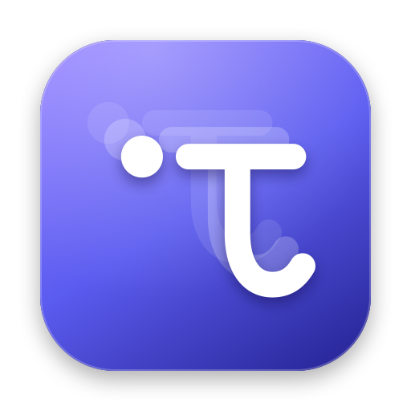

<p align="center">
  
</p>

<h1 align="center">Trace</h1>

<p align="center">
  A tiny, fast clipboard history for macOS — like <kbd>Win</kbd> + <kbd>V</kbd> on Windows, made for the Mac.
</p>

<p align="center">
  
  
  
</p>

---

Trace lives in your menu bar and remembers what you copy: text, rich text, links, images and files.
Press <kbd>⌃</kbd> <kbd>⌘</kbd> <kbd>V</kbd> anywhere and a Liquid Glass panel drops down from the menu bar
icon with your history. Pick an item and Trace pastes it straight into the app you were using.

## Features

- **Everything you copy** — plain and rich text, links, colours (`#6A61F5` shows a swatch), images with
  previews, and files from Finder.
- **Instant search** — type to filter; every word is matched, in any order, also against the source app's name.
- **Keyboard first** — arrows to move, <kbd>↩</kbd> to paste, <kbd>⇧</kbd><kbd>↩</kbd> to paste as plain text,
  <kbd>⌘</kbd><kbd>1</kbd>…<kbd>⌘</kbd><kbd>9</kbd> for the first nine items.
- **Pin** what you use often; pinned items are never trimmed or cleared.
- **Configurable shortcut** and panel position (below the menu bar icon or at the mouse pointer).
- **Privacy** — skips passwords and content that password managers mark as confidential or transient
  ([nspasteboard.org](http://nspasteboard.org) types), lets you exclude apps, and can pause recording.
  History never leaves your Mac.
- **Open at login** (optional), English and Italian interface.
- **Featherweight** — no dependencies, ~15 MB of memory and 0% CPU when idle, even with 1,000 items.

### Shortcuts in the panel

| Keys | Action |
| --- | --- |
| <kbd>⌃</kbd><kbd>⌘</kbd><kbd>V</kbd> | Open / close Trace (configurable) |
| <kbd>↑</kbd> <kbd>↓</kbd> (<kbd>⌘</kbd> to jump) | Move the selection |
| <kbd>↩</kbd> | Paste the selected item |
| <kbd>⇧</kbd><kbd>↩</kbd> | Paste as plain text |
| <kbd>⌘</kbd><kbd>1</kbd> … <kbd>⌘</kbd><kbd>9</kbd> | Paste one of the first nine items |
| <kbd>⌘</kbd><kbd>P</kbd> | Pin / unpin |
| <kbd>⌘</kbd><kbd>⌫</kbd> | Delete the selected item |
| <kbd>⌘</kbd><kbd>,</kbd> | Settings |
| <kbd>esc</kbd> | Clear the search, then close |

Right-click an item for more (copy without pasting, open link, show in Finder…).
Right-click the menu bar icon for Pause, Clear History, Settings and Quit.

## Install

1. Download **Trace-1.0.0-beta.dmg** from the [latest release](https://github.com/SkryxDev/Trace/releases/latest).
2. Open it and drag **Trace** into **Applications**.
3. Trace is not notarized yet, so macOS blocks it the first time. Open it once, then go to
   **System Settings › Privacy & Security** and click **Open Anyway** — or run:

   ```bash
   xattr -dr com.apple.quarantine /Applications/Trace.app
   ```

## Permissions

| Permission | Why | Where |
| --- | --- | --- |
| **Paste from Other Apps** | macOS asks the first time Trace reads the clipboard. Choose **Allow** so it can record your copies. | System Settings › Privacy & Security › Paste from Other Apps |
| **Accessibility** *(optional)* | Lets Trace press <kbd>⌘</kbd><kbd>V</kbd> for you after you pick an item. Without it, the item is only copied. | System Settings › Privacy & Security › Accessibility |

> **Accessibility already allowed but Trace still asks?** macOS ties the permission to the app's
> signature. Builds signed ad hoc (the default for local builds) get a new identity every time, so
> remove Trace from the Accessibility list with **−** and allow it again. Release builds are signed
> with a certificate, so the permission survives updates.

## Build from source

Requirements: **macOS 27** or later and **Xcode 27** or later. There are no third-party dependencies.

```bash
git clone https://github.com/SkryxDev/Trace.git
cd Trace
open Trace.xcodeproj
```

Then press <kbd>⌘</kbd><kbd>R</kbd> in Xcode. To build a release copy from the command line instead:

```bash
xcodebuild -project Trace.xcodeproj -scheme Trace -configuration Release -derivedDataPath build build
```

The app is written to `build/Build/Products/Release/Trace.app`; copy it to `/Applications`:

```bash
cp -R build/Build/Products/Release/Trace.app /Applications/
```

To build the signed, drag-to-install disk image used for releases:

```bash
Scripts/make-dmg.sh beta
```

It signs with your Developer ID or Apple Development certificate when one is installed (override
with `SIGN_IDENTITY="…"`), and writes `dist/Trace-<version>-beta.dmg`.

The icons are generated by a script; after changing the artwork run:

```bash
swift Scripts/generate-icons.swift
```

## How it works

```
Trace/
├── App/            Entry point, menu bar item and wiring
├── Clipboard/      Pasteboard monitor, history store, paste helper
├── Hotkey/         Global shortcut (Carbon) and the shortcut recorder
├── Panel/          The Liquid Glass history panel (AppKit window + SwiftUI)
├── Settings/       Settings, About and Welcome windows
└── Support/        Preferences, app info cache, brand, system helpers
```

- macOS has no clipboard notification, so Trace checks the pasteboard's `changeCount` twice a second
  with a tolerant timer (the system coalesces the wake-ups) and only reads the contents when it changed.
- History metadata is a small JSON file; the copied data is stored per item under
  `~/Library/Application Support/Trace/` and only read back when pasting or drawing a thumbnail.
- The panel is a non-activating `NSPanel`, so the app you are working in stays active and receives the
  paste. Its SwiftUI content is created when it opens and released when it closes; thumbnails are
  generated with ImageIO/QuickLook off the main thread and dropped from memory shortly after.
- The global shortcut uses `RegisterEventHotKey`, which needs no special permission.

## License

Trace is free software: you can redistribute it and/or modify it under the terms of the
[GNU General Public License v3.0](LICENSE) or (at your option) any later version.

## Credits

Made by **[SkryxDev](https://github.com/SkryxDev)**.
